# Grafana en Kubernetes con Deployment y ReplicaSet

Tarea individual — **Configuración de clúster (Docker Swarm / Kubernetes)**
Autor: **Jhonatan Tipan**

Despliegue de **Grafana** (plataforma de visualización y monitoreo) en un clúster local de Kubernetes (minikube), aplicando los objetos **ReplicaSet** y **Deployment**, y exponiéndolo fuera del clúster con un **Service NodePort**.

---

## 1. Objetivo

1. Desplegar una plataforma distinta a la vista en clase (en clase se usó el deployment `hola`) → se eligió **Grafana 11.3**.
2. Aplicar **ReplicaSet**: réplicas, auto-reparación y escalado.
3. Aplicar **Deployment**: gestión de ReplicaSets, escalado, *rolling update*, *rollback* y reinicio controlado.
4. Configurar y **exponer** la plataforma (Secret, ConfigMap, Service).
5. Explicar los **usos** de la plataforma y de estos objetos.

## 2. Entorno

| Componente | Versión |
|---|---|
| Sistema operativo | Windows 11 |
| Clúster | minikube v1.39.0 (driver Docker) |
| Kubernetes | v1.37.0 |
| kubectl | v1.34.1 |
| Imagen | `grafana/grafana:11.3.0` / `11.3.1` |

## 3. Arquitectura

```
                    Navegador / curl
                           │
          minikube service (túnel)  →  http://127.0.0.1:<puerto>
                           │
┌──────────────────────── Namespace: monitoreo ─────────────────────────┐
│                                                                       │
│   Service grafana (NodePort 30300 → 3000, sessionAffinity ClientIP)   │
│                           │  balancea entre                           │
│         ┌─────────────────┼─────────────────┐                         │
│       Pod 1             Pod 2             Pod 3                       │
│         └─────────────────┴─────────────────┘                         │
│                           ▲ crea y vigila                             │
│              ReplicaSet grafana-<hash> (3 réplicas)                   │
│                           ▲ crea y versiona                           │
│                    Deployment grafana                                 │
│                                                                       │
│   Secret grafana-admin        ConfigMap grafana-provisioning          │
│   (usuario/clave admin)       (datasource + dashboard como código)    │
└───────────────────────────────────────────────────────────────────────┘
```

## 4. Estructura del repositorio

```
k8s-grafana-deployment/
├── k8s/
│   ├── 00-namespace.yaml    # Namespace "monitoreo"
│   ├── 01-secret.yaml       # Credenciales del admin de Grafana
│   ├── 02-configmap.yaml    # Datasource TestData + dashboard aprovisionados
│   ├── 03-replicaset.yaml   # Parte 1: ReplicaSet puro (3 réplicas)
│   ├── 04-deployment.yaml   # Parte 2: Deployment (3 réplicas, RollingUpdate, probes)
│   └── 05-service.yaml      # Service NodePort 30300
├── evidencias/              # Salida real de cada comando ejecutado (.txt)
└── capturas/                # Capturas de pantalla (.png)
```

## 5. Conceptos aplicados

| | **Pod** | **ReplicaSet** | **Deployment** |
|---|---|---|---|
| Qué es | Unidad mínima: uno o más contenedores | Controlador que mantiene **N pods idénticos** | Controlador que administra **ReplicaSets** |
| Si un pod muere | Se pierde | Lo recrea | Lo recrea (a través de su ReplicaSet) |
| Escalado | No | `kubectl scale rs` | `kubectl scale deploy` |
| Actualizar imagen | Recrear a mano | **No actualiza** los pods existentes | **Rolling update** sin caída |
| Rollback | No | No | `kubectl rollout undo` |
| Uso recomendado | Pruebas puntuales | Rara vez directo | **Forma estándar** de desplegar apps sin estado |

Relación: **Deployment → ReplicaSet → Pods**. Cada cambio en el `template` del Deployment crea un ReplicaSet nuevo; los antiguos se conservan con 0 réplicas (`revisionHistoryLimit: 5`) para poder volver atrás.

### Puntos clave de la configuración

- **`replicas: 3`**: tres instancias de Grafana para alta disponibilidad.
- **`strategy.rollingUpdate`**: `maxSurge: 1` y `maxUnavailable: 0`, así que durante una actualización nunca hay menos de 3 pods disponibles.
- **`readinessProbe` / `livenessProbe`** sobre `/api/health`: el Service solo envía tráfico a pods listos, y un pod colgado se reinicia.
- **`resources`**: *requests* y *limits* de CPU y memoria.
- **Secret** inyectado como variables de entorno (`GF_SECURITY_ADMIN_USER/PASSWORD`).
- **ConfigMap** montado con `subPath`: el datasource y el dashboard se definen como código, así que todas las réplicas son idénticas e intercambiables.
- **Service NodePort** con `sessionAffinity: ClientIP`: cada réplica guarda las sesiones de login en su propio SQLite, y la afinidad mantiene a cada usuario en el mismo pod.

## 6. Cómo reproducirlo

```bash
minikube start

# Configuración base
kubectl apply -f k8s/00-namespace.yaml -f k8s/01-secret.yaml -f k8s/02-configmap.yaml

# Parte 1: ReplicaSet
kubectl apply -f k8s/03-replicaset.yaml
kubectl get rs,pods -n monitoreo
kubectl delete pod <un-pod> -n monitoreo          # auto-reparación
kubectl scale rs grafana-rs --replicas=5 -n monitoreo
kubectl delete rs grafana-rs -n monitoreo

# Parte 2: Deployment + Service
kubectl apply -f k8s/04-deployment.yaml -f k8s/05-service.yaml
kubectl rollout status deploy/grafana -n monitoreo
kubectl scale deploy/grafana --replicas=5 -n monitoreo
kubectl set image deploy/grafana grafana=grafana/grafana:11.3.1 -n monitoreo
kubectl rollout history deploy/grafana -n monitoreo
kubectl rollout undo deploy/grafana -n monitoreo
kubectl rollout restart deploy/grafana -n monitoreo

# Exposición (con driver Docker en Windows deja la terminal abierta)
minikube service grafana -n monitoreo --url
```

Acceso: usuario `admin`, contraseña `Grafana2026!` (valores de demo definidos en `01-secret.yaml`). También se puede ver el dashboard sin iniciar sesión, en modo solo lectura.

## 7. Evidencias

Todas las capturas de terminal corresponden a la salida real guardada en [`evidencias/`](evidencias).

### 7.1 Namespace, Secret y ConfigMap
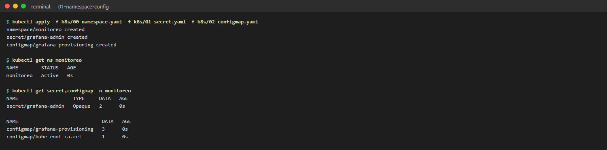

### Parte 1 — ReplicaSet

#### 7.2 ReplicaSet creado con 3 réplicas
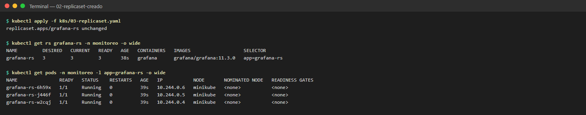

#### 7.3 Auto-reparación
Se elimina el pod `grafana-rs-6h59x` y el ReplicaSet crea `grafana-rs-96t8v` para volver al estado deseado (3). Los eventos `SuccessfulCreate` del `replicaset-controller` lo confirman.
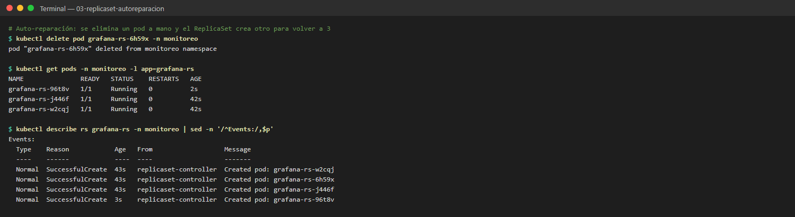

#### 7.4 Escalado de 3 a 5 réplicas
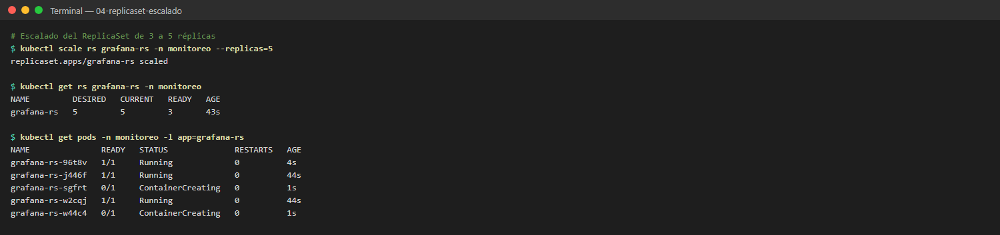

#### 7.5 Limitación del ReplicaSet
Se cambia la imagen a `11.3.1`, pero los pods existentes **siguen en `11.3.0`**: un ReplicaSet solo usa el template para crear pods nuevos. Por eso en la práctica se usa un Deployment.
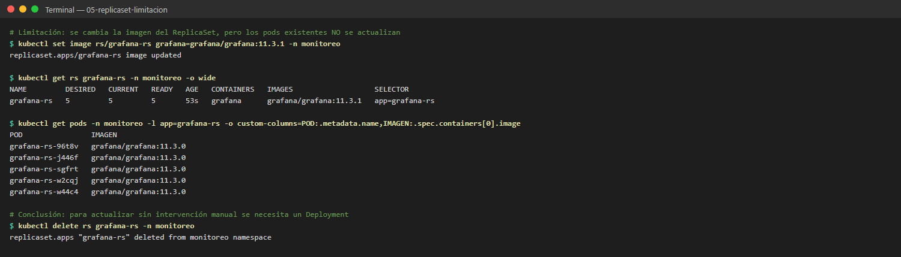

### Parte 2 — Deployment

#### 7.6 Deployment creado: cadena de propietarios
El Deployment `grafana` es dueño del ReplicaSet `grafana-65d96cff87`, que a su vez es dueño de los 3 pods (`ownerReferences`).
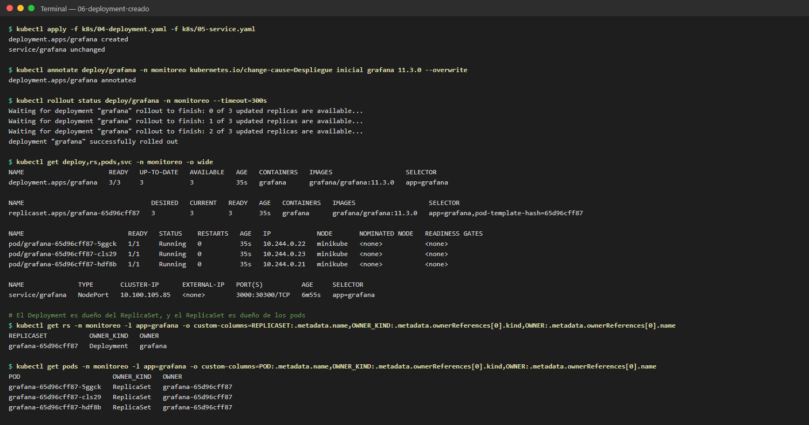

#### 7.7 Escalado 3 → 5 → 3
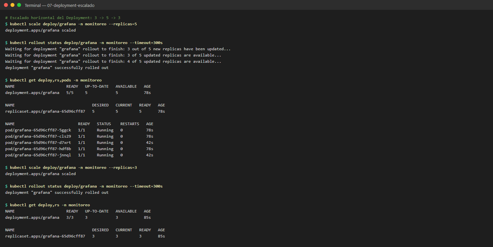

#### 7.8 Auto-reparación a través del Deployment
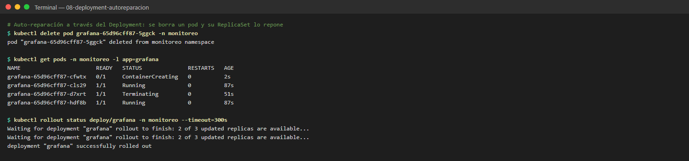

#### 7.9 Rolling update a Grafana 11.3.1
El Deployment crea un **ReplicaSet nuevo** (`grafana-58c4584fd`) y va subiendo uno y bajando el otro de a un pod (0→1→2→3 / 3→2→1→0), sin bajar nunca de 3 pods disponibles. El ReplicaSet viejo queda con 0 réplicas.
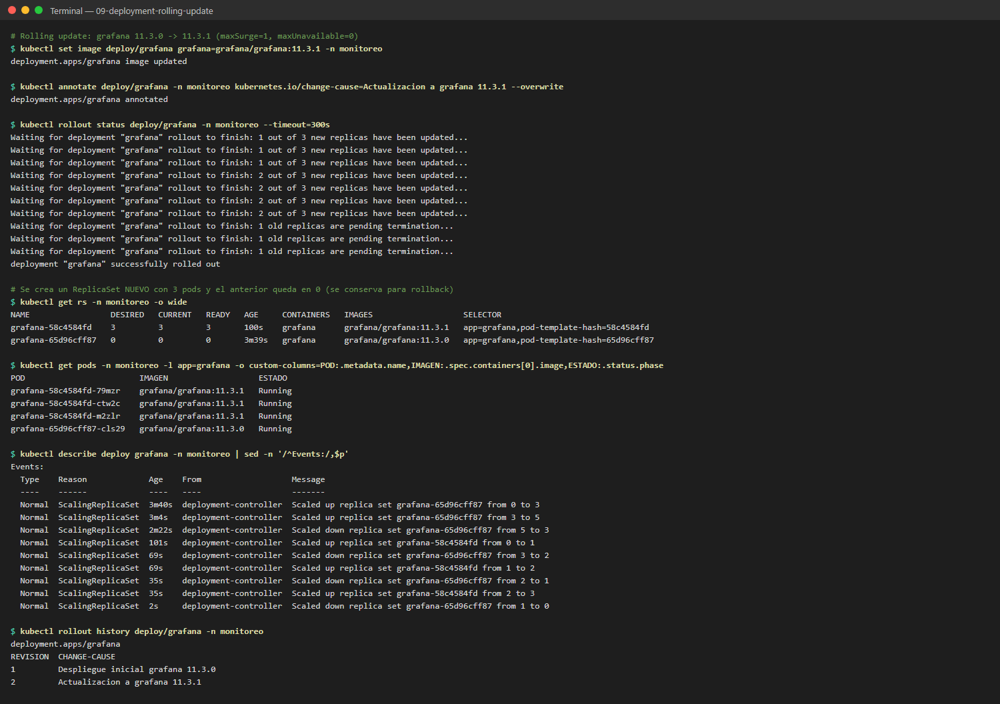

#### 7.10 Rollback
`kubectl rollout undo` reactiva el ReplicaSet anterior (`grafana-65d96cff87`, imagen 11.3.0).
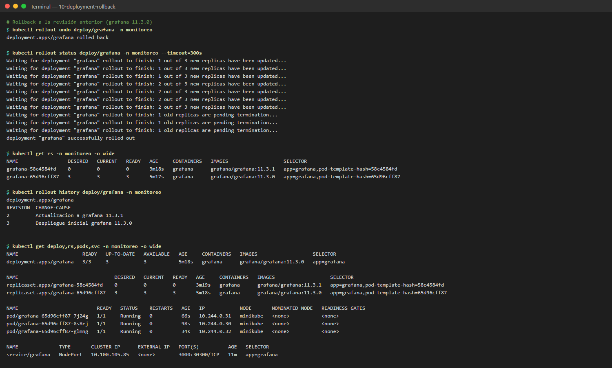

#### 7.11 Recarga de configuración con `rollout restart`
Tras modificar el ConfigMap, `kubectl rollout restart` reemplaza los pods de forma progresiva (revisión 4), sin caída del servicio.
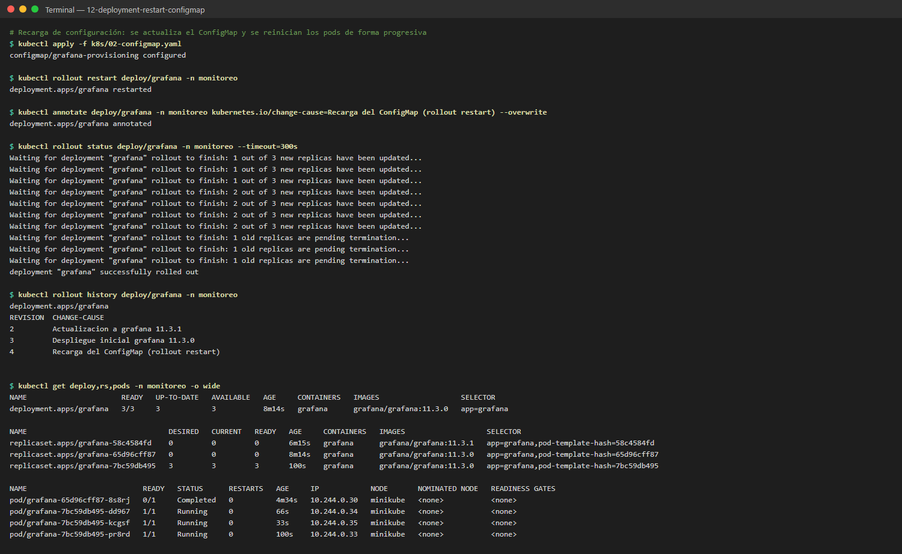

### Exposición de la plataforma

#### 7.12 Service NodePort, endpoints y verificación HTTP
El Service balancea entre los 3 endpoints (IPs de los pods). Con `curl` se comprueba la salud de Grafana, el datasource y el dashboard aprovisionados.
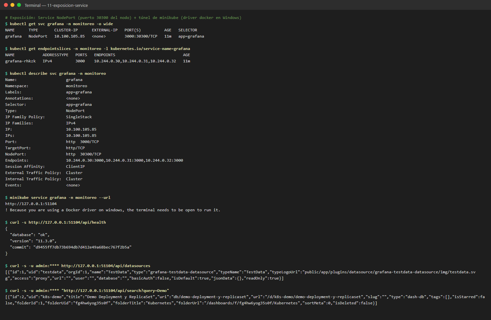

#### 7.13 Grafana en el navegador: dashboard aprovisionado
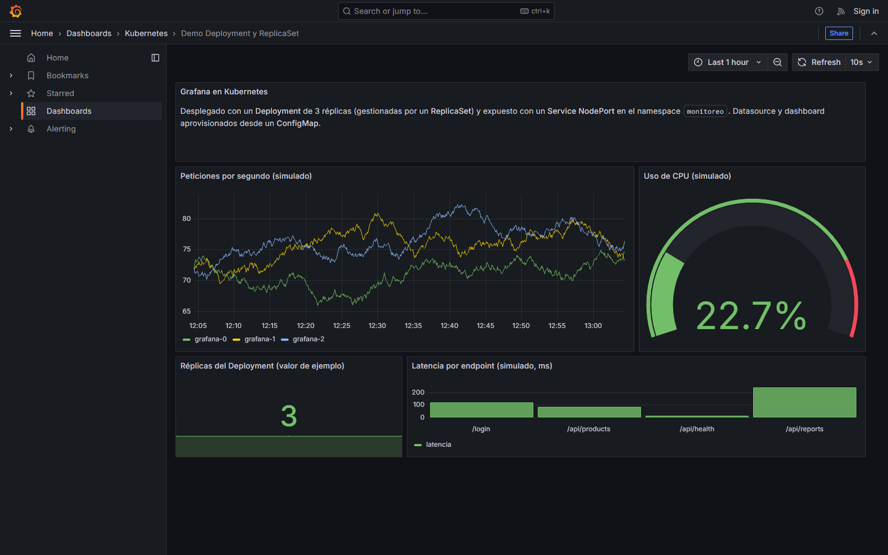

#### 7.14 Pantalla de login de Grafana
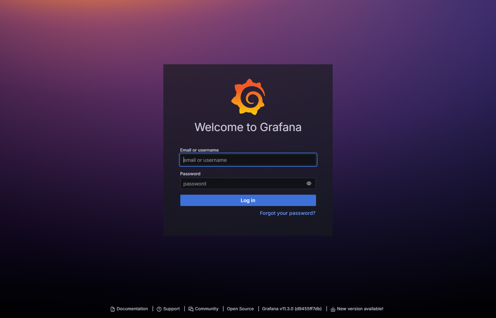

## 8. Usos

### 8.1 Usos de Grafana

- **Monitoreo de infraestructura y de Kubernetes**: CPU, memoria, red y estado de nodos y pods, junto con **Prometheus** (kube-prometheus-stack).
- **Observabilidad de aplicaciones**: latencia, tasa de errores y peticiones por segundo de APIs y microservicios.
- **Centralización de logs y trazas** con Loki y Tempo, correlacionados en un mismo panel.
- **Alertas**: notificaciones a correo, Slack, Teams o Telegram cuando una métrica supera un umbral.
- **Paneles de negocio (BI)**: ventas, inventario o KPIs leídos directamente desde SQL Server, MySQL o PostgreSQL. Por ejemplo, el nivel de stock y los productos por caducar de un sistema de inventario.
- **IoT e industria**: sensores, temperatura y producción en tiempo real (InfluxDB, MQTT).
- **Pipelines CI/CD**: duración de builds, despliegues y calidad de código (Jenkins, SonarQube).

### 8.2 Usos de ReplicaSet y Deployment

- **Alta disponibilidad**: si un pod o un nodo falla, se recrea automáticamente sin intervención.
- **Escalado horizontal**: atender más usuarios aumentando réplicas, de forma manual o automática con un **HorizontalPodAutoscaler**.
- **Despliegues sin caída (zero downtime)**: publicar versiones nuevas con *rolling update*.
- **Recuperación rápida ante errores**: *rollback* inmediato a la versión estable anterior.
- **Estrategias avanzadas**: *canary* y *blue/green* combinando Deployments y labels.
- **Infraestructura como código**: los YAML versionados en Git permiten reproducir el entorno exacto (base de GitOps con Argo CD o Flux).

> Nota: Grafana con varias réplicas en producción debe usar una base de datos compartida (PostgreSQL/MySQL) en lugar de SQLite, para que usuarios, sesiones y dashboards creados desde la interfaz se compartan entre pods. En esta práctica eso se resuelve con aprovisionamiento por ConfigMap y `sessionAffinity`. Para servicios con estado propio (bases de datos) se usa **StatefulSet** en lugar de Deployment.

## 9. Conclusiones

- El **ReplicaSet** garantiza el número de réplicas (auto-reparación y escalado), pero no gestiona versiones: los pods existentes no se actualizan al cambiar el template.
- El **Deployment** agrega una capa sobre el ReplicaSet: cada cambio crea un ReplicaSet nuevo, lo que permite *rolling updates* sin caída, historial de revisiones y *rollback*. Por eso es la forma recomendada de desplegar aplicaciones sin estado.
- Separar la configuración (**ConfigMap**) y las credenciales (**Secret**) de la imagen hace que las réplicas sean idénticas y reproducibles.
- El **Service** desacopla el acceso de los pods: aunque estos se recreen y cambien de IP, la plataforma sigue accesible en el mismo puerto.

## 10. Limpieza

```bash
kubectl delete namespace monitoreo
```
